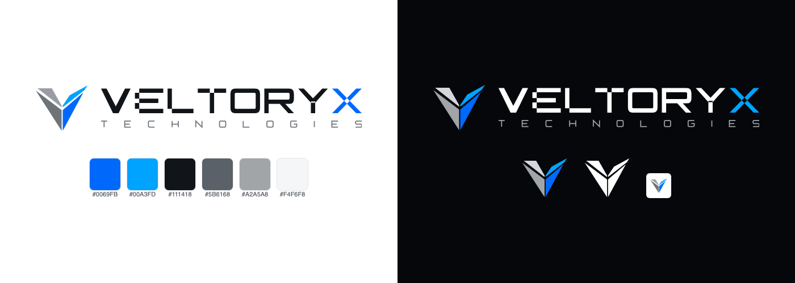

# Veltoryx Technologies brand kit



**Name:** Veltoryx Technologies (short form: Veltoryx)
**Tagline:** Build. Scale. Evolve.
**Website:** https://veltoryxtech.com

## Logo

The logo is a split **V** mark (steel on the left, blue on the right) with the **VELTORYX** wordmark, where the final **X** is blue. Use the flat vector files here for anything on screen. The glowing artwork in `source/` is for social media posts and banners only.

| File | Use it for |
|---|---|
| `logo/veltoryx-logo-horizontal-*.svg` | Website header, documents, email signatures. **Default logo.** |
| `logo/veltoryx-logo-stacked-*.svg` | Square spaces: posters, title slides, about pages |
| `logo/veltoryx-mark-*.svg` | Icon only: favicons, avatars, small spaces |
| `logo/veltoryx-wordmark-*.svg` | VELTORYX text only, when the mark is shown nearby |
| `logo/veltoryx-wordmark-full-*.svg` | VELTORYX with TECHNOLOGIES under it |
| `png/` | PNG copies with transparent backgrounds, for tools that don't accept SVG |
| `png/veltoryx-profile-picture.png` | GitHub, LinkedIn, X and other profile pictures |
| `source/veltoryx-logo-glow-*.png` | Original glowing artwork for social media only |

**Variants:** `-light` is for light backgrounds, `-dark` is for dark backgrounds. `-mono-black` and `-mono-white` are single colour, for printing, watermarks or busy photos.

**Do:**
- Leave clear space around the logo of at least the height of the letter **V** in the wordmark.
- Keep the horizontal logo at least 120 px wide on screen and the mark at least 16 px.

**Don't:**
- Stretch, rotate, recolour or add effects (shadows, glow, outlines) to the flat logo.
- Put the light logo on dark or busy backgrounds. Use the dark or mono variant instead.
- Rewrite the wordmark in a font. The letters are custom shapes.

## Colours

Sampled from the original logo artwork. Also available as `colors.css` (CSS variables) and `tokens.json`.

| Name | Hex | Use | Contrast |
|---|---|---|---|
| Veltoryx Blue | `#0069FB` | Primary buttons, links, highlights, the X | 4.76:1 on white ✅ |
| Blue hover | `#0055D4` | Hover and pressed states | 6.46:1 on white ✅ |
| Sky | `#00A3FD` | Accents, gradients, links on dark backgrounds | 7.35:1 on black ✅ (not for text on white) |
| Graphite | `#111418` | Main text on light backgrounds | 18.47:1 on white ✅ |
| Slate | `#5B6168` | Secondary text on light backgrounds | 6.26:1 on white ✅ |
| Steel | `#6E7378` | Logo left blade on light backgrounds | |
| Silver | `#A2A5A8` | Logo left blade on dark backgrounds, muted text on dark | 8.15:1 on black ✅ |
| Mist | `#F4F6F8` | Light section backgrounds | |
| Border | `#E3E6EA` | Borders and dividers | |
| Black | `#05070A` | Dark section backgrounds | |

The website uses one accent colour, Veltoryx Blue, on mostly white pages with occasional dark sections.

## Fonts

All free on Google Fonts.

| Font | Use |
|---|---|
| [Inter](https://fonts.google.com/specimen/Inter) | Headings and body text |
| [JetBrains Mono](https://fonts.google.com/specimen/JetBrains+Mono) | Code blocks and technical labels |

The wordmark is drawn as custom shapes, so no display font is needed for the logo.

## Favicon and app icons

Everything in `favicon/` is ready to copy into a website's `public/` folder:

```html
<link rel="icon" href="/favicon.ico" sizes="48x48">
<link rel="icon" href="/favicon.svg" type="image/svg+xml">
<link rel="apple-touch-icon" href="/apple-touch-icon.png">
<link rel="manifest" href="/site.webmanifest">
```

In Next.js (App Router), put `favicon.ico`, `icon.svg` (renamed from `favicon.svg`) and `apple-icon.png` (renamed from `apple-touch-icon.png`) in `src/app/` instead.

## Social share images

`social/veltoryx-og-light.png` and `social/veltoryx-og-dark.png` are 1200×630 images for link previews (Open Graph and Twitter cards). Use the light version by default.

## Editing the logo

The flat logo files are generated by `tools/generate-logo.py` (Python 3, no extra packages). Change the shapes or colours there and run:

```bash
python3 brand/tools/generate-logo.py brand/logo
```

PNG files are rendered from the SVGs with headless Google Chrome.
